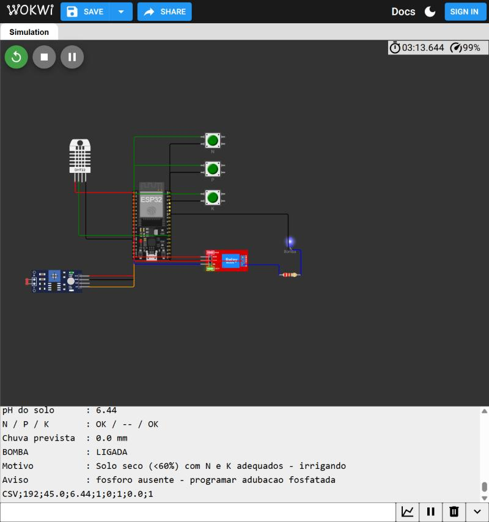
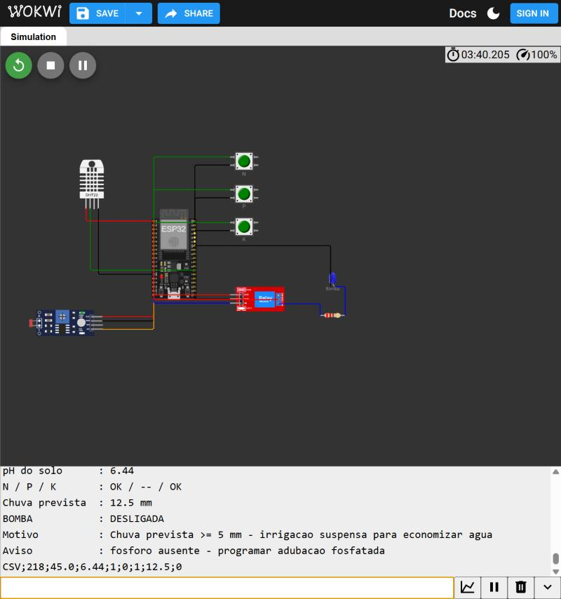
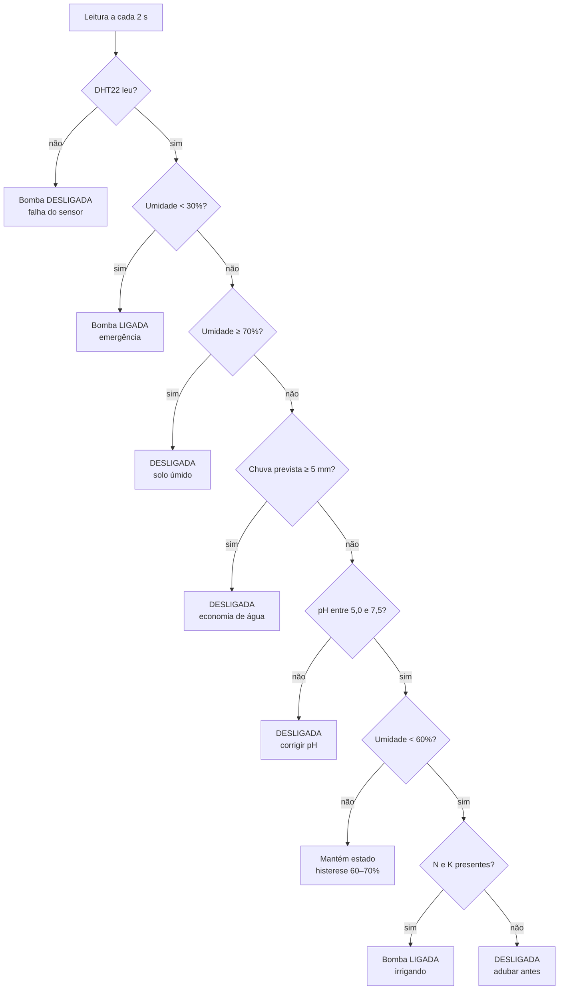
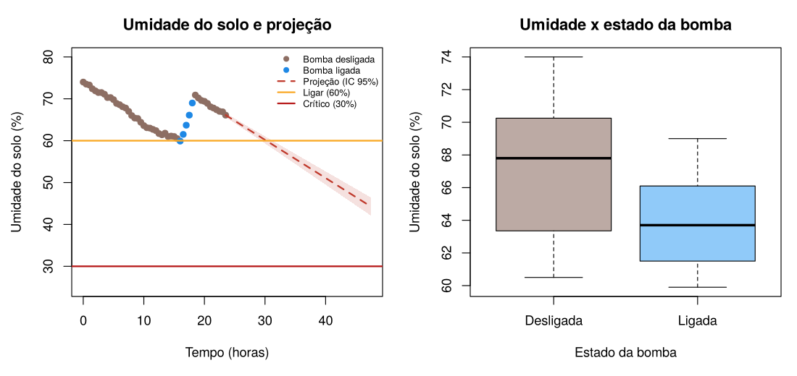

# FIAP - Faculdade de Informática e Administração Paulista

# FarmTech Solutions – Irrigação Inteligente com ESP32 (Fase 2)

## 👨‍🎓 Integrantes
- Tárcio Filipe de Almeida Barros – RM576489

## 👩‍🏫 Professores
### Tutor(a)
- Sabrina Otoni
### Coordenador(a)
- André Godoi

---

## 📜 Descrição

Sistema de **irrigação automatizado e inteligente** para uma lavoura de **cana-de-açúcar**,
simulado no [Wokwi.com](https://wokwi.com) com um **ESP32**. O dispositivo monitora em tempo real
a umidade do solo, o pH e os níveis de nitrogênio (N), fósforo (P) e potássio (K), e decide sozinho
quando ligar a bomba d'água, representada por um **relé azul**.

### 🎥 Vídeo de demonstração
**Link do YouTube (não listado):** https://youtu.be/VfESdDAzXzE

---

## 🔌 Circuito no Wokwi

**Projeto no Wokwi (abre a simulação pronta):** https://wokwi.com/projects/477820034562567169

**Bomba ligada:** solo seco (45%), pH 6,44, N e K presentes e sem chuva prevista. O LED azul acende junto com o relé.



**Irrigação suspensa:** mesma situação, mas com 12,5 mm de chuva prevista digitados no Monitor Serial.



### Sensores e substituições didáticas

| Grandeza real | Componente no Wokwi | Pino ESP32 | Como funciona na simulação |
|---|---|---|---|
| Nitrogênio (N) | Botão verde **N** | GPIO 13 | Cada toque alterna entre **presente** e **ausente** (true/false) |
| Fósforo (P) | Botão verde **P** | GPIO 14 | Idem |
| Potássio (K) | Botão verde **K** | GPIO 27 | Idem |
| pH do solo | LDR (*photoresistor sensor*) – saída AO | GPIO 34 (ADC) | A leitura de 0 a 4095 é convertida em pH de **0 a 14**. Mais luz resulta em pH maior (cerca de 70 lux ≈ pH 6,2) |
| Umidade do solo | DHT22 (umidade do ar) | GPIO 4 | O slider de umidade do DHT22 representa a umidade do solo (%) |
| Bomba d'água | Relé (módulo azul) + LED azul "Bomba" | GPIO 26 | O relé liga a bomba, e o LED acende quando ela está ligada |

### Como o NPK altera o pH (ajuste manual do LDR)

Não existe sensor de pH no Wokwi. Por isso, quando os níveis de N, P ou K mudam, o **operador ajusta o LDR à mão**
para refletir a mudança de pH que aquela adubação causaria no solo. A cada toque em um botão, o ESP32 mostra no
Monitor Serial **em que direção mover o LDR**:

| Botão | Efeito agronômico no pH | Ação no LDR | Variação didática |
|---|---|---|---|
| **N** presente | Adubos nitrogenados (ureia, sulfato de amônio) **acidificam** o solo | **Diminuir** a luz | pH cai cerca de 0,5 |
| **N** ausente | O solo acidifica menos | Aumentar um pouco a luz | pH sobe levemente |
| **P** presente | Fosfatos acidificam **levemente** | Diminuir um pouco a luz | pH cai cerca de 0,2 |
| **K** presente/ausente | Cloreto de potássio é praticamente **neutro** | Manter | pH quase não muda |

Exemplo exibido no Serial ao ligar o N:
```
>> Nutriente N: PRESENTE
   pH: adubo nitrogenado (ureia/amonio) ACIDIFICA o solo -> DIMINUA a luz do LDR (pH cai ~0,5)
```

Na demonstração, partindo de cerca de 80 lux (pH ≈ 6,4), basta reduzir o LDR para cerca de 63 lux (pH ≈ 5,9)
depois de ligar o N. O novo pH entra na decisão de irrigação na leitura seguinte. Se a acidificação levar o pH
abaixo de 5,0, a bomba não liga e o sistema pede calagem.
As variações de 0,5 e 0,2 são valores **didáticos** para a simulação.

Os botões usam `INPUT_PULLUP` (sem resistor externo) e *debounce* de 200 ms. O relé é alimentado em 5 V, e
seu contato NO aciona o LED azul através de um resistor de 220 Ω, simulando a bomba.

---

## 🌱 Cultura escolhida: cana-de-açúcar

| Parâmetro | Valor usado | Justificativa |
|---|---|---|
| Nutrientes que **bloqueiam** a irrigação | **N e K** | O potássio é o nutriente mais extraído pela cana (até 220 kg de K por 100 t de colmos), e o nitrogênio é aplicado todo ano na soqueira. Irrigar sem eles dissolve pouco nutriente e desperdiça água. |
| Fósforo (P) | Apenas **alerta** | O P é importante sobretudo no plantio. A falta dele gera um aviso para programar adubação fosfatada, mas não impede a irrigação. |
| pH aceitável | **5,0 a 7,5** | A absorção de nutrientes cresce muito até o pH 6,0–6,5 (de 26,7% em pH 4,5 para 79,5% em pH 6,0). Fora da faixa, o solo precisa de correção (calagem) antes da irrigação. |
| Umidade crítica | **< 30%** | Estresse hídrico: irriga em qualquer situação para salvar a lavoura |
| Ponto de irrigação | **< 60%** | Abaixo desse valor, o solo precisa de água |
| Solo na umidade ideal | **≥ 70%** | Desliga a bomba |
| Chuva que suspende a irrigação | **≥ 5 mm em 24 h** | A chuva repõe a água, então a irrigação é adiada para economizar |

Os limiares de umidade (30%, 60% e 70%) e de chuva (5 mm) são **decisões de projeto** do grupo para a simulação.

---

## 🧠 Lógica de decisão da bomba

As regras são avaliadas **nesta ordem** a cada 2 segundos. A primeira regra verdadeira decide.

| # | Condição | Bomba | Motivo exibido |
|---|---|---|---|
| 1 | Falha na leitura do DHT22 | **Desliga** | Segurança |
| 2 | Umidade < 30% | **Liga** | Emergência: tem prioridade sobre chuva, pH e nutrientes |
| 3 | Umidade ≥ 70% | **Desliga** | Solo já úmido |
| 4 | Chuva prevista ≥ 5 mm | **Desliga** | Economia de água |
| 5 | pH < 5,0 ou > 7,5 | **Desliga** | Corrigir o solo (calagem) antes de irrigar |
| 6 | Umidade < 60% **e** N e K presentes | **Liga** | Solo seco e nutrido |
| 6b | Umidade < 60% **e** falta N ou K | **Desliga** | Adubar antes de irrigar |
| 7 | Umidade entre 60% e 70% | **Mantém** o estado | Histerese: evita liga/desliga contínuo da bomba |



A decisão fica isolada na função `decidirIrrigacao()`, que não lê pinos. Por isso ela foi testada fora
do simulador com 13 cenários (todos os ramos e os valores-limite) antes de ir para o Wokwi.

### Saída no Monitor Serial

```
----------------------------------------------
Umidade do solo : 45.0 %
pH do solo      : 6.44
N / P / K       : OK / -- / OK
Chuva prevista  : 0.0 mm
BOMBA           : LIGADA
Motivo          : Solo seco (<60%) com N e K adequados - irrigando
Aviso           : fosforo ausente - programar adubacao fosfatada
CSV;192;45.0;6.44;1;0;1;0.0;1
```

A linha `CSV;...` traz as leituras em formato de dados, que podem ser analisadas no R (Ir além 2).

---

## ▶️ Como executar no Wokwi

1. Acesse [wokwi.com](https://wokwi.com), faça login e crie um projeto **ESP32**.
2. Substitua o conteúdo de `sketch.ino` e `diagram.json` pelos arquivos da pasta `src/esp32/`.
3. Na aba **Library Manager**, clique em **+** e adicione **DHT sensor library** (Adafruit) e **Adafruit Unified Sensor**.
   O Wokwi cria sozinho o arquivo `libraries.txt`, igual ao de `src/esp32/libraries.txt`.
4. Clique em ▶️ para iniciar a simulação e interaja:
   - **Botões N, P e K:** cada toque alterna o nutriente entre presente e ausente;
   - **DHT22:** clique no sensor e mova o slider *Humidity*;
   - **LDR:** clique no sensor e mova o slider de luz (cerca de 70 lux ≈ pH 6,2; 100 lux ≈ pH 7,0);
   - **Monitor Serial:** digite os mm de chuva previstos (ex.: `12.5`) e tecle Enter.

---

## 🚀 Ir além

### Opcional 1 – Python + API de previsão do tempo

`src/python/previsao_chuva.py` consulta a chuva prevista para as próximas 24 horas na API pública
**Open-Meteo**, que é gratuita e não exige chave. Se a variável de ambiente `OPENWEATHER_API_KEY`
estiver definida, o script usa a **OpenWeather**. O padrão é Recife/PE (Zona da Mata, polo canavieiro),
e outro local pode ser informado por latitude e longitude:

```bash
python src/python/previsao_chuva.py
python src/python/previsao_chuva.py -22.72 -47.65 "Piracicaba/SP"
```

O script mostra o total de chuva e a decisão sugerida, e salva a consulta em `ultima_previsao.json`.
Como a integração automática entre Python e Wokwi não está disponível no plano gratuito, o valor é
**transferido pelo Monitor Serial**: digite o número exibido pelo script e o ESP32 o lê com
`Serial.available()` / `Serial.read()`. Com 5 mm ou mais, a irrigação é suspensa.

### Opcional 2 – Análise estatística em R

`src/r/analise_irrigacao.R` lê as leituras no mesmo formato da linha `CSV;` do Monitor Serial.
O exemplo `data/leituras_exemplo.csv` traz 24 horas de leituras a cada 30 minutos. O script:

1. calcula a estatística descritiva da umidade (média, mediana, desvio padrão e quartis);
2. ajusta uma **regressão linear** da umidade em função do tempo no trecho de secagem (bomba desligada), obtendo a **taxa de secagem** em % por hora, com R² e p-valor;
3. **projeta** em quantas horas o solo chega a 60% e a 30%, com intervalo de previsão de 95%;
4. **decide**: *ligar agora*, *programar irrigação* (se chegar a 60% em até 6 h) ou *aguardar*.

```bash
Rscript src/r/analise_irrigacao.R
```

Resultado com os dados de exemplo: o solo perde **0,91% de umidade por hora** (R² = 0,987, p < 0,001)
e deve chegar a 60% em cerca de **6,8 h**. Por isso a decisão é **aguardar**.



---

## 📁 Estrutura de pastas

```
├── assets/                  imagens do circuito e da análise em R
├── data/
│   └── leituras_exemplo.csv leituras no formato da linha CSV do ESP32
├── src/
│   ├── esp32/
│   │   ├── sketch.ino       código C/C++ do ESP32
│   │   ├── diagram.json     circuito do Wokwi
│   │   └── libraries.txt    bibliotecas usadas no Wokwi
│   ├── python/
│   │   └── previsao_chuva.py  Ir além 1 – API de previsão de chuva
│   └── r/
│       └── analise_irrigacao.R Ir além 2 – análise estatística
└── README.md
```

---

## 📚 Referências

- WERNERSBACH FILHO, H. I.; TORRES, R. A. *Cana-de-açúcar: adubação de formação e manutenção*. Anais do 40º Rio Leite Serrano. Embrapa – Repositório Alice. Disponível em: https://www.alice.cnptia.embrapa.br/alice/bitstream/doc/595424/1/Cana-de-acucar.pdf
- Open-Meteo – API de previsão do tempo. https://open-meteo.com/
- Wokwi – documentação do ESP32 e dos componentes. https://docs.wokwi.com/

## 📋 Licença

Projeto acadêmico desenvolvido para a FIAP, sob a licença [CC BY 4.0](http://creativecommons.org/licenses/by/4.0/).
